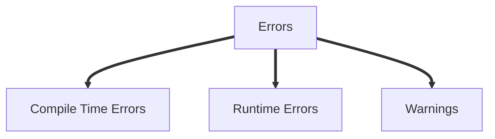
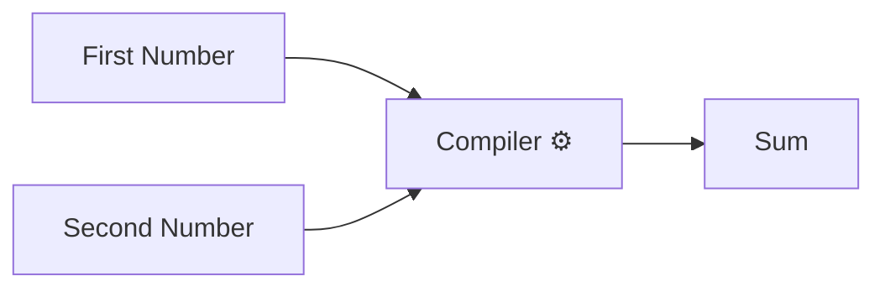
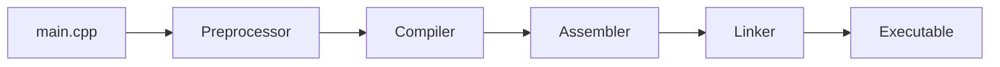
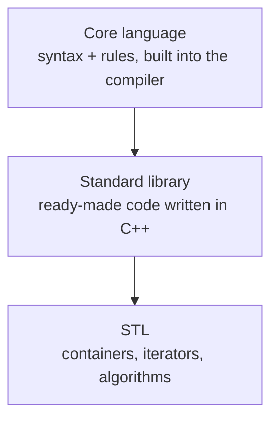

# Introduction

```cpp
#include <iostream>


int main(){
    std::cout << "Hello World!" << std::endl;
    return 0; 
}

```

In the above example program, at the top of the program the `#include <iostream>` is used to import a library which allows the use of std::cout, which is a print function.

- CPP statements need to end with semi-colon `;`

- A function is a block of code which does many things, in CPP main fuction should be always included, because it instructs the compiler where the code runs from, apart from main, an user can define any number of functions
  
- Main function is also called the entry point of a program, because it is the very first thing that is run when we run a cpp program
  
- Statements in the main function are run in order from top to bottom, and the program is going to end with it hits the end of the function block
  
- `std:endl;` is used to insert a new line, whereas the `std::cout` is used to print text in the terminal.

- The `return 0;` is used as a way for the main function to send the message to the operating system if it finished successfully or if there was a problem

# Comments

Comments are statements in CPP which will be ignored by the compiler and wont be shown during the execution of the program.

- There are two types of comments
  - Single Line Comments
  - Multi-line comments

Comments are used to add developer notes, todo lists, explain how the program works, or just ignore a few statements during testing, logging changes.

> **⚠️ Note: You cannot nest comments in CPP**

### Single Line Comments
Used to comment a single line of code
- Single line comments are started with `//`

### Multi-Line Comments
Used to comment multiple lines of code
- Multi-line line comments are started with `/*` and end with `*/`

Example Of Comments:

```cpp
#include <iostream>

int main() {
    std::cout << "Hello World!" << std::endl; //THIS IS A SINGLE LINE COMMENT
    return 0;
    /* This is an example of
    multi
    line
    comment
    */
}
```

> **📝 Tip: Comments are used to document your code, however it is not a good practice to not overdo comments in your code**


# Errors and Warnings

There are three kinds of errors


# Compile-Time Errors

Compile-time errors are mistakes the compiler catches **before** your program is built. No executable is produced until you fix them.

## Common Types

### 1. Syntax error
```cpp
int x = 10      // missing semicolon
```
`error: expected ';'`

### 2. Undeclared variable
```cpp
count = 5;      // never declared
```
`error: 'count' was not declared in this scope`

### 3. Type mismatch
```cpp
int n = "hello";   // text into an int
```
`error: invalid conversion from 'const char*' to 'int'`

### 4. Changing a const
```cpp
const int x = 5;
x = 10;
```
`error: assignment of read-only variable 'x'`

### 5. Wrong function arguments
```cpp
int add(int a, int b) { return a + b; }
add(1);         // too few arguments
```
`error: too few arguments to function 'add'`

### 6. Redeclaration
```cpp
int a = 1;
int a = 2;      // same name, same scope
```
`error: redeclaration of 'int a'`

### 7. Private access
```cpp
class Account { int balance; };
Account a;
a.balance = 100;   // private
```
`error: 'balance' is private within this context`

### 8. Creating an abstract class object
```cpp
struct Shape { virtual double area() = 0; };
Shape s;
```
`error: cannot declare variable 's' to be of abstract type 'Shape'`

### 9. Template error
```cpp
std::sort(v.begin(), v.end());   // type has no operator<
```
`error: no match for 'operator<'`

### 10. Failed static_assert
```cpp
static_assert(sizeof(int) == 8, "int must be 8 bytes");
```
`error: static assertion failed`

## Linker Error (a different stage)

The code compiles, but a function is declared and never defined:

```cpp
void foo();
int main() { foo(); }
```
`undefined reference to 'foo()'`

<hr>

# Runtime Errors

Runtime errors happen **while the program is running**. The code compiled fine, but something goes wrong when it executes.

## Common Types

### 1. Null pointer dereference
```cpp
int* p = nullptr;
*p = 5;              // crash
```
`Segmentation fault`

### 2. Out-of-bounds access
```cpp
int arr[3] = {1, 2, 3};
std::cout << arr[10];    // undefined behavior
```
May print garbage or crash. With `std::vector`, `v.at(10)` throws `std::out_of_range` instead.

### 3. Division by zero
```cpp
int a = 10, b = 0;
std::cout << a / b;
```
`Floating point exception` (crash)

### 4. Uncaught exception
```cpp
throw std::runtime_error("oops");   // no try/catch
```
`terminate called after throwing an instance of 'std::runtime_error'`

### 5. Stack overflow (infinite recursion)
```cpp
void f() { f(); }
```
`Segmentation fault`

### 6. Use after free
```cpp
int* p = new int(5);
delete p;
std::cout << *p;     // memory already freed
```
Undefined behavior.

### 7. Double free
```cpp
int* p = new int(5);
delete p;
delete p;            // freed twice
```
`free(): double free detected`

### 8. Memory leak
```cpp
int* p = new int(5);
// never deleted
```
No crash, but memory is wasted. Fix by using `std::unique_ptr`.

### 9. Uninitialized variable
```cpp
int x;
std::cout << x;      // random value
```
Undefined behavior.

### 10. Out of memory
```cpp
int* big = new int[1000000000000];
```
`terminate called after throwing an instance of 'std::bad_alloc'`

### 11. Infinite loop
```cpp
while (true) { }
```
Program hangs. Stop it with `Ctrl + C`.


<hr>

# Warnings

Warnings are **not errors**. The program still compiles, but the compiler is telling you the code looks risky or wrong.

## Common Types

### 1. Unused variable
```cpp
int x = 5;           // never used
```
`warning: unused variable 'x'`

### 2. Unused parameter
```cpp
void f(int a) { }
```
`warning: unused parameter 'a'`

### 3. Uninitialized variable
```cpp
int x;
std::cout << x;
```
`warning: 'x' is used uninitialized`

### 4. Missing return
```cpp
int f() { }          // no return statement
```
`warning: no return statement in function returning non-void`

### 5. Signed/unsigned comparison
```cpp
std::vector<int> v{1, 2, 3};
for (int i = 0; i < v.size(); i++) { }
```
`warning: comparison of integer expressions of different signedness`

### 6. Narrowing conversion
```cpp
double d = 3.14;
int n = d;           // loses the .14
```
`warning: conversion from 'double' to 'int' may change value`

### 7. Switch fallthrough
```cpp
switch (x) {
    case 1: doA();   // no break
    case 2: doB(); break;
}
```
`warning: this statement may fall through`

### 8. Assignment in a condition
```cpp
if (x = 5) { }       // meant ==
```
`warning: suggest parentheses around assignment used as truth value`

### 9. printf format mismatch
```cpp
printf("%d", 3.14);
```
`warning: format '%d' expects 'int', but argument has type 'double'`

> ⚠️ **Note:** Do not worry about the programs or the technical words mentioned above, they are only there to make you understand the concept, we will be covering them later on
 


 # Statements and Functions

 - A statement is a basic unit of computation in a C++ program
 - Every C++ program is a collection of statements organised in a certain way to achieve some goal 
 - Statements end with a `;` (semi-colon)


```cpp

int main (int argc, char **argv){

    int firstNumber = 20;
    int secondNumber = 10;

    int sum = firstNumber + secondNumber;

    std::cout << "The Sum Of the Two Numbers is: : " << sum << std::endl;

    return 0;
}

```

- Statements are executed in order from top to bottom when the program is run.
- Execution keeps going until there is a statement causing the program to terminate, or run another sequence of statements.



A funnction is like a machine, you give it input and it will give you an output.
For ex: In the above flowchart, the first number and second number are inputs and the sum is the output

CPP has a special syntax used to define functions, as shown below

```cpp
int addNUmbers(int firstNumber, int secondNumber){
    int sum = firstNumber + secondNumber;
    return sum;
}
```
- Everything inside the `(int firstNumber, int secondNumber)` or `()` are called the function parameters
- A function starts with a function type `int` (here), then a function name `addNumbers` (here) and then the parameters, followed by `{}`
- All the statements to be run in the function are stored inside the `{}`

- A function must be defined before it's use

```cpp
int addNumbers(int firstNumber, int secondNumber){
    int sum = firstNumber + secondNumber;
    return sum;
}

int main (int argc, chat **argv){
    int firstNUmber = 20;
    int secondNumber = 10;

    sum = addNumbers(firstNumber, secondNumber);

    sum = addNumbers(33,23);

    std::cout << "The sum of two numbers is: " << sum << std::endl;
    std::cout << "The sum of two numbers is: " << addNumbers(33,24) << std::endl;

    return 0;

}
```
- Functions thus are, reusable pieces of code that group together a bunch of statements to do whatever we want to do in that function.


# Input/Output

C++ handles input and output with **streams**. Include `<iostream>` for console I/O.

## Console Output

### `cout`: print to the screen
```cpp
#include <iostream>

int main() {
    std::cout << "Hello" << std::endl;
    std::cout << "Age: " << 20 << "\n";
}
```
`<<` is the **insertion operator**. Use `"\n"` instead of `std::endl` when you don't need to flush the buffer (it's faster).

### `cerr` and `clog`: print errors and logs
```cpp
std::cerr << "Something went wrong\n";   // unbuffered, for errors
std::clog << "Log message\n";            // buffered, for logs
```

## Console Input

### `cin`: read a value
```cpp
int age;
std::cin >> age;

int a, b;
std::cin >> a >> b;     // read multiple values
```
`>>` is the **extraction operator**. It stops reading at whitespace.

### `getline`: read a full line
```cpp
#include <string>

std::string name;
std::getline(std::cin, name);   // reads "Prahaas Kumar" fully
```

### Common mistake: `cin` followed by `getline`
```cpp
int age;
std::string name;
std::cin >> age;
std::getline(std::cin, name);   // gets an empty string!
```
`cin >> age` leaves the newline in the buffer. Fix it by clearing it first:
```cpp
std::cin >> age;
std::cin.ignore();              // discard the leftover newline
std::getline(std::cin, name);
```

Don't mix `cin`/`cout` with `scanf`/`printf` after this.


# C++ Execution Model & Memory Model


This section explain what happens to a C++ program from source file to exit, using this example:

```cpp
#include <iostream>

int add_numbers(int a, int b)
{
    return a + b;
}

int main()
{
    int a = 10;
    int b = 5;
    int c;

    std::cout << "Statement1" << std::endl;
    std::cout << "Statement2" << std::endl;
    c = add_numbers(a, b);
    std::cout << "Statement3" << std::endl;
    std::cout << "Statement4" << std::endl;

    return 0;
}
```

---

## 1. Source code is only text

A `.cpp` file is plain text. The CPU cannot run it and has no concept of `int`, `std::cout` or "functions". Something must translate it into instructions the processor understands. That is the compiler's job.

---

## 2. Compiling: source to instructions

The flowchart shows a single "Compiler" box. Real toolchains (GCC, Clang, MSVC) do four jobs in sequence:



| Stage | What it does |
|---|---|
| Preprocessor | Handles `#` lines. `#include <iostream>` pastes the header in so `std::cout` and `std::endl` are known. No translation yet. |
| Compiler | Parses syntax, checks types, resolves names, and translates each statement into low-level (assembly) instructions. Errors here are compile errors and nothing runs. |
| Assembler | Turns the assembly text into binary machine code, stored in an object file (`.o` / `.obj`). |
| Linker | Joins your object code with library code (the code behind `std::cout`) and fixes up addresses so calls point to the right place. |

### What the compiler checks

- Syntax is valid.
- Types match (`int a = 10;` is fine, `int a = "hello";` is an error).
- Names resolve (`add_numbers(a, b)` must match a declared function taking two `int`s).

### Source to compiled steps (as shown on the slide)

| C++ source | Compiled step |
|---|---|
| `int a = 10;` | `a = 10 (int)` |
| `int b = 5;` | `b = 5 (int)` |
| `int c;` | `c (int)` |
| `std::cout << "Statement1" << std::endl;` | `print("Statement1")` |
| `std::cout << "Statement2" << std::endl;` | `print("Statement2")` |
| `c = add_numbers(a, b);` | `c = f_add(a, b)` |
| `std::cout << "Statement3" << std::endl;` | `print("Statement3")` |
| `std::cout << "Statement4" << std::endl;` | `print("Statement4")` |
| `return 0;` | `end` |

The right-hand column is a readable stand-in. Real output is binary, and each line there is really several machine instructions.

---

## 3. Loading: the OS creates a process

When you run the executable, the operating system:

1. Creates a process and reserves memory for it.
2. Copies the instructions into the code (text) region.
3. Sets up a stack and a heap.
4. Starts the C++ runtime, which calls `main()`.

### Memory regions

```
 low addresses
┌──────────────────────────┐
│ Code (text)              │  compiled instructions, read-only
├──────────────────────────┤
│ Static / global          │  globals and static variables (none here)
├──────────────────────────┤
│ Heap                     │  new / malloc (unused here)
│            ↓ grows       │
│                          │
│            ↑ grows       │
├──────────────────────────┤
│ Stack                    │  local variables, one frame per call
└──────────────────────────┘
 high addresses
```

- **Code:** the program's instructions.
- **Static/global:** lives for the whole program. This example has none.
- **Heap:** manual allocation with `new` / `malloc`. Not used here.
- **Stack:** local variables and function calls. This is where most of the action happens.

---

## 4. Execution, statement by statement

The CPU keeps a program counter pointing at the next instruction. It runs one instruction, moves to the next, and only jumps on a function call, branch or loop. The slide's point is that execution is sequential.

### Entering `main`

The stack gets a new frame for `main`'s locals. The compiler already worked out how much space `a`, `b` and `c` need, so it is reserved in one step.

### `int a = 10;` and `int b = 5;`

The values 10 and 5 are written into the slots for `a` and `b`.

### `int c;`

Space is reserved but nothing is written. `c` holds leftover bits (garbage) until it is assigned. Reading it before then is undefined behavior. This is why the slide shows `c (int)` with no value.

### `std::cout << "Statement1" << std::endl;` (and Statement2)

This calls into the standard library, which puts the text in an output buffer. `std::endl` adds a newline and flushes the buffer so the text appears on screen.

```
Statement1
Statement2
```

### `c = add_numbers(a, b);`

This is the most involved step. Stack while `add_numbers` runs:

```
┌─────────────────────────────┐
│ add_numbers() frame         │
│   a = 10  (copy)            │
│   b = 5   (copy)            │
│   return value = 15         │
├─────────────────────────────┤
│ main() frame                │
│   a = 10                    │
│   b = 5                     │
│   c = ?   (not set yet)     │
└─────────────────────────────┘
```

1. The values of `a` and `b` are copied to where the function expects its arguments. On common 64-bit platforms this is usually CPU registers, not the stack.
2. The `call` instruction saves the return address (the instruction after the call) on the stack and jumps to `add_numbers`.
3. `add_numbers` gets its own frame with its own `a` and `b`. These are copies, so changing them inside the function does not affect `main`'s variables.
4. It computes `a + b` = 15 and places the result in the return register.
5. `ret` pops the return address, the frame is discarded, and execution jumps back into `main`.
6. `main` stores the returned 15 into `c`.

Afterwards the stack shrinks back to just `main`'s frame, and `c = 15`.

### Statement3 and Statement4

These print the same way as the first two. The final output is:

```
Statement1
Statement2
Statement3
Statement4
```

The addition happens silently between statements 2 and 3, because nothing prints its result.

### `return 0;`

`main` hands 0 back to the runtime as the exit code, meaning success. This corresponds to `end` on the slide.

---

## 5. Shutdown

The runtime flushes any remaining output, runs cleanup code and exits. The OS reclaims the process's memory. Stack variables are not freed one by one; the whole address space goes away.

---


## To Summarize

1. The preprocessor, compiler, assembler and linker turn text into an executable.
2. The OS loads it and calls `main`.
3. The CPU runs instructions in order. Locals live in stack frames, and a function call pushes a new frame that is destroyed on return.
4. `main` returns 0, the process exits, and the OS reclaims the memory.


# C++ Core Language VS Standard Library VS STL

These three terms are often mixed up. They are three layers, each built on the one before it.

```
┌──────────────────────────────────────────────────────────┐
│ C++ Standard Library                                     │
│   iostream, string, thread, chrono, filesystem, memory…  │
│                                                          │
│   ┌──────────────────────────────────────────────────┐   │
│   │ STL (the containers / iterators / algorithms     │   │
│   │      part of the standard library)               │   │
│   │   vector, map, set, sort, find, iterators…       │   │
│   └──────────────────────────────────────────────────┘   │
└────────────────────────────┬─────────────────────────────┘
                             │ written using
                             ▼
┌──────────────────────────────────────────────────────────┐
│ C++ Core Language                                        │
│   keywords, types, operators, control flow, functions,   │
│   classes, templates, references, exceptions, lambdas…   │
└──────────────────────────────────────────────────────────┘
```



In one sentence each:

- **Core language:** the grammar and rules of C++ itself.
- **Standard library:** ready-made code, written in C++, that ships with every compiler and is guaranteed by the standard.
- **STL:** the generic containers-and-algorithms portion of the standard library.

---

## 1. The core language

The core language is what the compiler understands directly. It is the syntax and the meaning of that syntax. You need no `#include` to use any of it.

### What belongs to it

| Category | Examples |
|---|---|
| Keywords | `if`, `else`, `for`, `while`, `return`, `class`, `struct`, `template`, `namespace`, `const`, `auto` |
| Built-in types | `int`, `char`, `bool`, `float`, `double`, `void`, pointers, references, arrays |
| Operators | `+`, `-`, `*`, `/`, `=`, `==`, `&&`, `<<` (as a shift), `new`, `delete`, `sizeof` |
| Control flow | `if`, `switch`, loops, `break`, `continue`, `goto` |
| Functions | declarations, definitions, overloading, default arguments, lambdas |
| User-defined types | classes, structs, enums, unions, inheritance, virtual functions |
| Templates | the mechanism for writing generic code (not the generic code itself) |
| Memory-related rules | object lifetime, stack vs heap allocation, constructors and destructors (RAII) |
| Error handling mechanism | `try`, `throw`, `catch` |
| Compile-time features | `constexpr`, `static_assert`, `decltype` |

### Example: pure core language

```cpp
int add(int a, int b)       // function
{
    return a + b;
}

int main()
{
    int total = 0;                  // built-in type
    for (int i = 1; i <= 5; i++)    // loop
    {
        total = add(total, i);
    }
    return total > 10 ? 0 : 1;      // operators, conditional
}
```

There is no `#include` and no `std::` anywhere, and this compiles. Nothing here depends on a library.

### Key point

The compiler itself implements the core language. If it didn't understand `if`, nothing could make `if` work.

---

## 2. The standard library

The standard library is a large collection of types and functions that the C++ standard requires every conforming implementation to provide. It is ordinary C++ code, written using the core language.

Everything in it lives in the `std` namespace (that is why you write `std::cout`), and you must include the right header to use it.

### What belongs to it

| Area | Headers | Examples |
|---|---|---|
| Input / output | `<iostream>`, `<fstream>`, `<sstream>` | `std::cout`, `std::cin`, `std::ifstream` |
| Strings | `<string>`, `<string_view>` | `std::string`, `std::string_view` |
| Containers | `<vector>`, `<map>`, `<set>`, `<array>`, `<list>`… | `std::vector`, `std::unordered_map` |
| Algorithms | `<algorithm>`, `<numeric>` | `std::sort`, `std::find`, `std::accumulate` |
| Memory management | `<memory>` | `std::unique_ptr`, `std::shared_ptr`, `std::make_unique` |
| Concurrency | `<thread>`, `<mutex>`, `<atomic>`, `<future>` | `std::thread`, `std::mutex` |
| Time | `<chrono>` | `std::chrono::steady_clock` |
| Utilities | `<utility>`, `<optional>`, `<variant>`, `<tuple>` | `std::pair`, `std::optional` |
| Math | `<cmath>`, `<random>` | `std::sqrt`, `std::mt19937` |
| Filesystem | `<filesystem>` | `std::filesystem::path` |
| Error types | `<exception>`, `<stdexcept>` | `std::exception`, `std::runtime_error` |
| C library wrappers | `<cstdio>`, `<cstdlib>`, `<cstring>` | `std::printf`, `std::malloc`, `std::strlen` |

### Example: core language plus standard library

```cpp
#include <iostream>   // pulls in the library declarations
#include <string>

int main()
{
    std::string name = "C++";                       // library type
    std::cout << "Hello, " << name << std::endl;    // library object
    return 0;
}
```

Remove `#include <iostream>` and `std::cout` becomes an unknown name, so you get a compile error. The core language has no idea what `cout` is.

### Who writes it?

The standard only specifies the library's behavior. Compiler vendors write the actual code:

| Implementation | Used with |
|---|---|
| libstdc++ | GCC (default on most Linux) |
| libc++ | Clang / LLVM (default on macOS) |
| MSVC STL | Microsoft Visual C++ |

All three must behave according to the standard, but their internals differ.

### The "linker" connection

Some library code is header-only (templates like `std::vector`). Some is precompiled into a library file (like parts of `iostream`). In the build pipeline, the preprocessor pastes the headers into your file and the linker connects your program to the precompiled parts.

---

## 3. The STL

STL stands for Standard Template Library.

### Where it came from

Alexander Stepanov and Meng Lee designed it at HP in the 1990s as a library of generic data structures and algorithms. It was so successful that it was adopted into the first C++ standard (C++98). Since then it has been part of the standard library, not a separate product.

### Important note on the term

"STL" is not an official section name in the C++ standard. It is an informal name for the part of the standard library built around templates. People use it loosely, and some use "STL" to mean the entire standard library, which is technically inaccurate.

### The four pillars

| Component | Purpose | Examples |
|---|---|---|
| Containers | Store collections of objects | `vector`, `list`, `deque`, `map`, `set`, `unordered_map`, `array` |
| Iterators | Generalized pointers for walking through a container | `begin()`, `end()`, `it++`, `*it` |
| Algorithms | Operations that work on ranges of elements | `sort`, `find`, `count`, `reverse`, `transform`, `copy` |
| Function objects | Callable objects passed to algorithms | `std::less`, `std::greater`, lambdas, `std::function` |

(Allocators, which control how containers get memory, are sometimes listed as a fifth piece.)

### The central design idea

Algorithms do not know about containers. They only know about iterators. This is how one `std::sort` works on a `vector`, a `deque`, or a plain array.

```
   container ──provides──▶ iterators ◀──used by── algorithm
   (vector, list)          (begin, end)           (sort, find)
```

### Example: STL in action

```cpp
#include <vector>
#include <algorithm>
#include <iostream>

int main()
{
    std::vector<int> nums = {5, 2, 9, 1};          // container

    std::sort(nums.begin(), nums.end());           // algorithm + iterators

    auto it = std::find(nums.begin(), nums.end(), 9);   // algorithm returns iterator
    if (it != nums.end())
    {
        std::cout << "Found " << *it << std::endl;      // iostream is NOT STL
    }
}
```

`std::vector` and `std::sort` are STL. `std::cout` is part of the standard library, but it is not STL.

### Why "Template"?

Containers and algorithms are written once as templates, and the compiler generates the real code for each type you use. `std::vector<int>` and `std::vector<std::string>` are two separate classes generated at compile time. Templates are a core language feature, so the STL is the strongest example of the standard library being built on the core language.

---

## 4. Side-by-side comparison

| | Core language | Standard library | STL |
|---|---|---|---|
| What it is | Syntax and rules | Pre-written types and functions | Generic containers, iterators and algorithms |
| Who implements it | The compiler | Compiler vendor (libstdc++, libc++, MSVC STL) | Same, as part of the library |
| Needs `#include`? | No | Yes | Yes (`<vector>`, `<algorithm>`…) |
| Uses `std::`? | No | Yes | Yes |
| Example | `int`, `if`, `class`, `template` | `std::cout`, `std::string`, `std::thread` | `std::vector`, `std::sort`, iterators |
| Relationship | Foundation | Built on the core | Subset of the standard library |
| Official term in the standard? | Yes | Yes | No, informal |

### Classification 

| Item | Layer |
|---|---|
| `for` | Core language |
| `int` | Core language |
| `template<typename T>` | Core language |
| `std::vector` | STL (and standard library) |
| `std::sort` | STL (and standard library) |
| `std::map` | STL (and standard library) |
| `std::cout` | Standard library only |
| `std::string` | Standard library (often counted as STL because it behaves like a container) |
| `std::thread` | Standard library only |
| `std::unique_ptr` | Standard library only |
| `std::printf` | C standard library, included in the C++ standard library |

---

## 5. Where the layers blur

Some core language features depend on small pieces of the library:

| Core feature | Needs from the library |
|---|---|
| `typeid(x)` | `<typeinfo>` |
| `{1, 2, 3}` initializer lists | `<initializer_list>` |
| Three-way comparison `<=>` | `<compare>` |
| Coroutines (`co_await`) | `<coroutine>` |
| `new` throwing on failure | `std::bad_alloc` from `<new>` |
| Range-based `for` | works on arrays, or on anything with `begin()` / `end()` (all STL containers) |

So the core language is mostly independent, but a few features have a hook into the library.

### Freestanding vs hosted

- A hosted implementation (normal desktop programs) provides the full standard library.
- A freestanding implementation (embedded systems, operating system kernels) must provide only a small subset (such as `<cstddef>`, `<limits>`, `<type_traits>`, `<cstdint>`). The core language works there, but there may be no `iostream`, no threads, and sometimes no heap.

This is a practical demonstration that the core language and the library are separate things.

---

## 6. Which version added what

| Standard | Notable additions |
|---|---|
| C++98 | STL standardized: containers, iterators, algorithms, `std::string`, `iostream` |
| C++11 | `unique_ptr`, `shared_ptr`, `thread`, `unordered_map`, `array`, lambdas (core), `auto` (core) |
| C++14 | `make_unique`, generic lambdas |
| C++17 | `optional`, `variant`, `string_view`, `filesystem`, parallel algorithms |
| C++20 | Ranges, `span`, concepts (core), `format`, coroutines (core plus library) |
| C++23 | `expected`, `print`, more ranges features |

The core language and the library evolve together, but they are specified in separate parts of the standard.

---

## 7. Common misconceptions

1. **"STL means the entire standard library."** Not strictly. STL is the containers, iterators and algorithms part. `iostream`, `thread` and smart pointers are standard library but are not STL.
2. **"`std::cout` is part of the language."** No, it is a library object. The `<<` operator syntax is core language, but `cout` itself comes from `<iostream>`.
3. **"Library code is slower or magic."** It is normal C++ compiled by the same compiler, and for templates the code is generated right inside your program.
4. **"`new` and `delete` are library functions."** The operators are core language. Their default memory-handling functions (`operator new`) are provided by the library.
5. **"`std::string` is just a built-in type."** It is a class from `<string>`. String literals like `"hello"` are core language (`const char[6]`), but `std::string` is a library type.

---

## 8. Mapping back to the compile process

This links to the execution model notes:

| Pipeline stage | Core language | Standard library |
|---|---|---|
| Preprocessor | handles `#` lines | `#include <vector>` pastes library headers into your file |
| Compiler | parses and translates syntax, instantiates templates | template code (STL) is generated here for your types |
| Linker | resolves your function calls | connects to precompiled library code (e.g. the code behind `std::cout`) |
| Runtime | stack, heap, objects follow core rules | library code runs like any other code on your stack and heap |

---

## Summary

1. **Core language:** built into the compiler, no includes needed. It provides the rules: types, control flow, classes, templates.
2. **Standard library:** code written in C++ and shipped with the compiler. It provides the tools: I/O, strings, containers, threads, time, filesystem. It needs includes and lives in `std::`.
3. **STL:** the generic containers, iterators and algorithms inside the standard library. It is the best demonstration of templates in practice, and it is an informal term.

Core language is the grammar, the standard library is the vocabulary everyone agrees on, and the STL is the part of that vocabulary built to work on any data type.