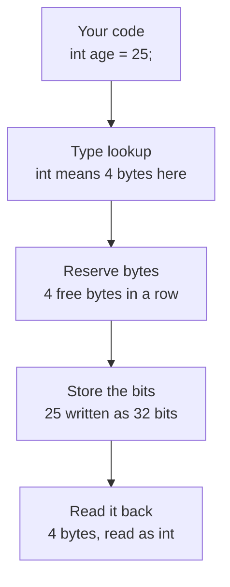
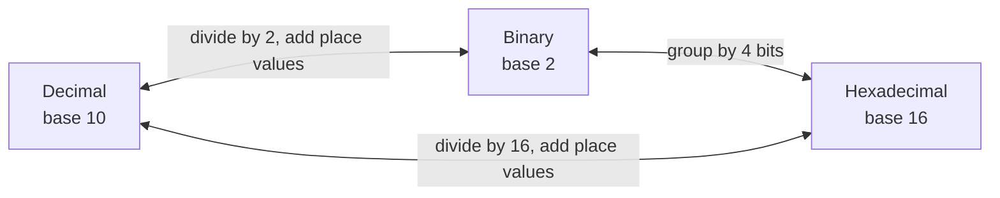
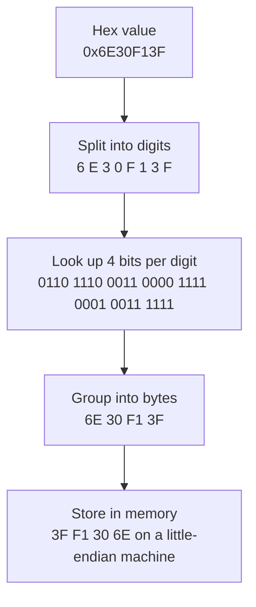

# Variables and Data Types Introduction


# How C++ data types use memory

Memory is one long run of bytes, and every byte is 8 bits. A variable is a chunk of those bytes, and its **type** decides two things:

1. **How many bytes** it claims.
2. **How the bits are read**: as a whole number, a decimal, a character, and so on.

The bits carry no type information of their own. The bytes `19 00 00 00` can be the `int` 25, or four unrelated characters. Only the declared type tells the compiler how to read them.

---

## What happens when you write `int age = 25;`



1. The compiler sees the type `int` and looks up its size (4 bytes on typical machines).
2. It finds 4 free, contiguous bytes at a suitably aligned address.
3. It writes `25` into them as binary.
4. Every later use of `age` reads those same 4 bytes and interprets them as an `int`.

---

## What the memory looks like

Each row below is 4 bytes (32 bits). Only the second row belongs to `age`. The other bits are leftovers from other variables and are arbitrary.

```
address   byte 0    byte 1    byte 2    byte 3
0x1000    01101110  00110000  11110001  00111111   other memory
0x1004    00011001  00000000  00000000  00000000   int age = 25
0x1008    10100101  01011100  00000011  11000010   other memory
```

Bytes are stored **lowest address first**, and on most machines (x86, ARM) the *least significant* byte comes first. This is called **little-endian**. So 25 (`0x00000019`) appears as `19 00 00 00`.

---

## Typical sizes

These are the usual values on a 64-bit desktop. C++ only guarantees `sizeof(char) == 1`, so use `sizeof` to check your own machine.

| Type | Typical size | Range or precision |
|------|--------------|--------------------|
| `char` | 1 byte | −128 to 127 (usually signed) |
| `bool` | 1 byte | `false` or `true` |
| `short` | 2 bytes | −32,768 to 32,767 |
| `int` | 4 bytes | −2,147,483,648 to 2,147,483,647 |
| `long` | 4 bytes on Windows, 8 on Linux and macOS | depends on size |
| `long long` | 8 bytes | about ±9.2 × 10¹⁸ |
| `float` | 4 bytes | about ±3.4 × 10³⁸, ~7 digits |
| `double` | 8 bytes | about ±1.8 × 10³⁰⁸, ~16 digits |
| pointer | 8 bytes (64-bit) | holds an address |

---

## Worked examples

Bytes are shown in memory order, lowest address first.

| Declaration | Bytes (hex) | Bits |
|-------------|-------------|------|
| `char c = 'A';` | `41` | `01000001` |
| `bool flag = true;` | `01` | `00000001` |
| `short s = 1000;` | `E8 03` | `11101000 00000011` |
| `int age = 25;` | `19 00 00 00` | `00011001 00000000 00000000 00000000` |
| `long long big = 5000000000;` | `00 F2 05 2A 01 00 00 00` | 64 bits, 5 of the 8 bytes are non-zero |
| `float f = 0.1f;` | `CD CC CC 3D` | `11001101 11001100 11001100 00111101` |
| `double d = 0.1;` | `9A 99 99 99 99 99 99 3F` | 64 bits |

### Things worth noticing

**Overflow wraps around.** A `char` has only 8 bits, so `char c = 300;` keeps just the low 8 bits. `300 − 256 = 44`, so you get `44`.

**Same number, different footprint.** `int n = 25;` uses 4 bytes. `long long n = 25;` uses 8, and the extra bytes are zeros.

**A `bool` costs a whole byte.** Memory is addressed per byte, so one yes/no still takes 8 bits.

**Decimals are approximations.** Neither `float` nor `double` can store 0.1 exactly:

| Type | Value actually stored |
|------|-----------------------|
| `float` | 0.100000001490116… |
| `double` | 0.100000000000000005551… |

The `double` just has more bits to get closer.

---

## How `float` and `double` use their bits

Floating-point numbers split their bits into three fields instead of storing a plain binary integer.

| Type | Sign | Exponent | Mantissa | Total |
|------|------|----------|----------|-------|
| `float` | 1 bit | 8 bits | 23 bits | 32 bits |
| `double` | 1 bit | 11 bits | 52 bits | 64 bits |

For `float f = 0.1f;` the 32 bits (`0x3DCCCCCD`) split as:

```
sign  exponent  mantissa
0     01111011  10011001100110011001101
```

---

## Alignment and padding

CPUs read memory fastest when a value sits at an address divisible by its size. That is why `int` lands at `0x1004` and `double` at `0x1008` in the examples above. The compiler may insert hidden **padding** bytes to keep things aligned:

```cpp
struct Example {
    char a;   // 1 byte, then 3 bytes of padding
    int  b;   // 4 bytes
};
// sizeof(Example) is typically 8, not 5
```

---

## Try it yourself

```cpp
#include <cstdio>
#include <cstring>

int main() {
    int age = 25;

    unsigned char bytes[sizeof(age)];
    std::memcpy(bytes, &age, sizeof(age));

    std::printf("sizeof(int) = %zu\n", sizeof(age));
    for (unsigned char b : bytes) {
        std::printf("%02X ", b);   // prints 19 00 00 00 on little-endian machines
    }
    std::printf("\n");
}
```

Change `age` to other values or types and watch how the bytes change.

---
# Number systems

Computers store everything as bits, which are tiny switches that are either off (`0`) or on (`1`). Long strings of 0s and 1s are hard for people to read and write, so we use **number systems** to describe the same values in friendlier ways.

A number system is a way of writing numbers with a fixed set of digits. The **base** is how many digits it has.

| System | Base | Digits | C++ prefix | Example (value 42) |
|--------|------|--------|------------|--------------------|
| Decimal | 10 | `0`–`9` | none | `42` |
| Binary | 2 | `0`, `1` | `0b` | `0b101010` |
| Hexadecimal | 16 | `0`–`9`, `A`–`F` | `0x` | `0x2A` |

All three examples are the same number. Only the way it is written changes.

---

## Place value

Every system works the same way. Each position is worth the base raised to a power, counting from the right starting at 0.

**Decimal** (base 10): `472`

```
  4       7       2
 ×100    ×10     ×1
= 400  +  70   +  2   = 472
```

**Binary** (base 2): `1101`

```
  1      1      0      1
 ×8     ×4     ×2     ×1
=  8  +  4   +  0   +  1  = 13
```

**Hexadecimal** (base 16): `2F`

```
  2       F (=15)
 ×16      ×1
= 32   +  15   = 47
```

---

## Counting from 0 to 16

Hex needs six extra digits after 9, so it borrows the letters A to F.

| Decimal | Binary | Hex |
|---------|--------|-----|
| 0 | `0000` | `0` |
| 1 | `0001` | `1` |
| 2 | `0010` | `2` |
| 3 | `0011` | `3` |
| 4 | `0100` | `4` |
| 5 | `0101` | `5` |
| 6 | `0110` | `6` |
| 7 | `0111` | `7` |
| 8 | `1000` | `8` |
| 9 | `1001` | `9` |
| 10 | `1010` | `A` |
| 11 | `1011` | `B` |
| 12 | `1100` | `C` |
| 13 | `1101` | `D` |
| 14 | `1110` | `E` |
| 15 | `1111` | `F` |
| 16 | `10000` | `10` |

When a system runs out of digits, it adds a new position to the left. Decimal does this after `9`, binary after `1`, and hex after `F`.

---

## Why these three?

**Binary** matches the hardware. A transistor is either off or on, so two digits are enough.

**Decimal** matches people. We count on ten fingers, so it is what we use for everyday numbers.

**Hexadecimal** is shorthand for binary. One hex digit is exactly 4 bits, so one byte (8 bits) is always exactly two hex digits.

```
binary   1011 0111
          │    │
hex       B    7     →  0xB7
```

That tidy fit is why memory addresses, colors (`#FF8800`), and raw bytes are usually written in hex.

---

## Converting between them



### Decimal to binary

Divide by 2 repeatedly and keep the remainders. Then read them from the bottom up.

```
45 ÷ 2 = 22  remainder 1
22 ÷ 2 = 11  remainder 0
11 ÷ 2 =  5  remainder 1
 5 ÷ 2 =  2  remainder 1
 2 ÷ 2 =  1  remainder 0
 1 ÷ 2 =  0  remainder 1
                         read upward → 101101
```

Check: 32 + 8 + 4 + 1 = 45.

### Binary to decimal

Add up the place values of every `1`. For `101101`:

```
 1    0    1    1    0    1
32   16    8    4    2    1
32 +  0 +  8 +  4 +  0 +  1 = 45
```

### Binary to hex

Split into groups of 4 bits from the right, then convert each group.

```
10110111  →  1011  0111  →  B  7  →  0xB7
```

### Hex to binary

Expand each hex digit into 4 bits.

```
0x3F  →  3 = 0011,  F = 1111  →  0011 1111  (63 in decimal)
```

### Decimal to hex

Divide by 16 repeatedly and read the remainders from the bottom up.

```
202 ÷ 16 = 12  remainder 10  (A)
 12 ÷ 16 =  0  remainder 12  (C)
                              read upward → CA
```

Check: 12 × 16 + 10 = 202.

### Hex to decimal

Multiply each digit by its place value. For `0x1F4`:

```
1×256 + 15×16 + 4×1 = 256 + 240 + 4 = 500
```

---

## Handy numbers to remember

Powers of 2:

| 2⁰ | 2¹ | 2² | 2³ | 2⁴ | 2⁵ | 2⁶ | 2⁷ | 2⁸ |
|----|----|----|----|----|----|----|----|----|
| 1 | 2 | 4 | 8 | 16 | 32 | 64 | 128 | 256 |

How many values fit in a given number of bits (unsigned):

| Bits | Distinct values | Range | Hex max |
|------|-----------------|-------|---------|
| 8 (1 byte) | 256 | 0 to 255 | `0xFF` |
| 16 | 65,536 | 0 to 65,535 | `0xFFFF` |
| 32 | 4,294,967,296 | 0 to 4,294,967,295 | `0xFFFFFFFF` |

With *n* bits you get 2ⁿ distinct values. Signed types give up half of that range to represent negative numbers.

---

## A real example: three bytes from memory

The same byte can be written all three ways. Here are bytes from a memory grid:

| Binary | Hex | Decimal | As an ASCII character |
|--------|-----|---------|-----------------------|
| `01101110` | `0x6E` | 110 | `n` |
| `00110000` | `0x30` | 48 | `0` |
| `11110001` | `0xF1` | 241 | not a printable ASCII character |

The bits never change. Binary, hex, and decimal are just three ways of writing them down.

---

## In C++

```cpp
#include <iostream>
#include <bitset>

int main() {
    int a = 42;        // decimal
    int b = 0b101010;  // binary (C++14 and later)
    int c = 0x2A;      // hexadecimal

    std::cout << std::boolalpha << (a == b && b == c) << '\n';  // true

    std::cout << std::dec << a << '\n';        // 42
    std::cout << std::hex << a << '\n';        // 2a
    std::cout << std::bitset<8>(a) << '\n';    // 00101010
}
```

- `a`, `b`, and `c` are identical once compiled. The prefix only changes how you type the number.
- `std::hex` and `std::dec` change how `cout` prints integers, and the setting stays on until you change it back.
- `std::bitset<N>` prints the raw bits of a value.
- C++14 also allows digit separators for readability, like `0b0010'1010`.

---


# How hexadecimal maps to bits

Memory only ever stores **bits**. Hexadecimal isn't a second way of storing data. It's a shorthand for *writing* those bits, so people don't have to read and type long strings of 0s and 1s.

`0x6E30F13F` and `01101110001100001111000100111111` are the same 32 bits. The hex version is just eight characters instead of thirty-two.

---

## Why 4 bits per digit

Hex is base 16, and 16 = 2⁴. Four bits can represent exactly 16 different values (`0000` to `1111`), and one hex digit can represent exactly 16 different values (`0` to `F`). So each hex digit lines up with one group of 4 bits, called a **nibble**.

| Hex | Bits | Hex | Bits |
|-----|------|-----|------|
| `0` | `0000` | `8` | `1000` |
| `1` | `0001` | `9` | `1001` |
| `2` | `0010` | `A` | `1010` |
| `3` | `0011` | `B` | `1011` |
| `4` | `0100` | `C` | `1100` |
| `5` | `0101` | `D` | `1101` |
| `6` | `0110` | `E` | `1110` |
| `7` | `0111` | `F` | `1111` |

Converting between hex and binary is a lookup for each digit, with no arithmetic. That's what makes hex so convenient. Decimal can't do this, because 10 isn't a power of 2.

---

## Worked example: `0x6E30F13F`



Each digit expands into its own 4 bits:

```
hex      6    E    3    0    F    1    3    F
bits   0110 1110 0011 0000 1111 0001 0011 1111
       └─────┘    └─────┘    └─────┘    └─────┘
        byte 0     byte 1     byte 2     byte 3
        0x6E       0x30       0xF1       0x3F
```

Two hex digits always make exactly one byte, so a 32-bit value is always 8 hex digits and a 16-bit value is always 4.

---

## Going the other way: bits to hex

Split the bits into groups of 4 **starting from the right**, then look each group up.

```
10110111  →  1011  0111  →  B  7  →  0xB7
```

If the bit count isn't a multiple of 4, pad with zeros on the **left**. Leading zeros don't change the value.

```
101101  →  0010  1101  →  2  D  →  0x2D
```

---

## Checking the value with place values

Each hex digit is worth 16 raised to its position, counting from the right starting at 0.

| Digit | Value | × Place | = |
|-------|-------|---------|---|
| `6` | 6 | 16⁷ = 268,435,456 | 1,610,612,736 |
| `E` | 14 | 16⁶ = 16,777,216 | 234,881,024 |
| `3` | 3 | 16⁵ = 1,048,576 | 3,145,728 |
| `0` | 0 | 16⁴ = 65,536 | 0 |
| `F` | 15 | 16³ = 4,096 | 61,440 |
| `1` | 1 | 16² = 256 | 256 |
| `3` | 3 | 16¹ = 16 | 48 |
| `F` | 15 | 16⁰ = 1 | 15 |
| | | **Total** | **1,848,701,247** |

---

## How the bytes sit in memory

Writing `0x6E30F13F` puts the most significant byte first. Most machines (x86, ARM) are **little-endian**, so they store the *least* significant byte at the lowest address.

```
address    0x1000     0x1001     0x1002     0x1003
byte         3F         F1         30         6E
bits       00111111   11110001   00110000   01101110
```

The same four bytes can be read in different ways depending on the type:

| Read as | Result |
|---------|--------|
| 32-bit unsigned integer | 1,848,701,247 |
| four separate bytes (memory order) | 63, 241, 48, 110 |

The bits never change. The type decides how they're interpreted.

---

## What about the `0x` prefix?

It isn't stored. `0x` is a signal to you and the compiler that the digits that follow are base 16. After compilation these are identical:

```cpp
unsigned int a = 0x6E30F13F;
unsigned int b = 1848701247;
unsigned int c = 0b01101110001100001111000100111111;   // C++14 and later
```

---

## In C++

```cpp
#include <bitset>
#include <cstdint>
#include <cstdio>
#include <cstring>
#include <iostream>

int main() {
    std::uint32_t value = 0x6E30F13F;

    std::cout << std::bitset<32>(value) << '\n';   // 01101110001100001111000100111111
    std::cout << std::dec << value << '\n';        // 1848701247
    std::cout << std::hex << value << '\n';        // 6e30f13f

    unsigned char bytes[4];
    std::memcpy(bytes, &value, sizeof(value));
    for (unsigned char b : bytes) {
        std::printf("%02X ", b);                   // 3F F1 30 6E on little-endian machines
    }
    std::printf("\n");
}
```

- `std::bitset<32>` prints the raw bits.
- `std::hex` and `std::dec` change how `cout` prints integers, and the setting stays on until you switch it back.
- The `memcpy` loop shows the real byte order in memory.

---

## Quick reference

| Fact | Detail |
|------|--------|
| 1 hex digit | 4 bits (a nibble) |
| 2 hex digits | 8 bits (1 byte) |
| 8 hex digits | 32 bits (typical `int`) |
| 16 hex digits | 64 bits (`long long`, `double`) |
| Largest 1 byte | `0xFF` = 255 |
| Largest 4 bytes | `0xFFFFFFFF` = 4,294,967,295 |

---

- All data is represented by a bunch of grouped cells of 0's and 1's in memory.
- As the range of your data grows, so will the number of digits you need to represent the data in memory.
- Hexadecimal system makes it a little easier for humans to handle streams of data with 1's and 0's.
- Octal has the same goal as Hexadecimal, but it's almost no longer used in modern times. It's just mentioned here for your awareness.


# Types of Initialising Variables

## Integers

- Stores decimals
- Typically occupies 4 bytes or more in memory


**Note:** A Variable is a named piece of memory that you use to store specific types of data.

### Variable Braced Initialisation
```cpp
int elephant_count;
int lion_count{}; //Initialise to zero

int dog_count {10}; // Initiliase to 10

int cat_count {15}; // Initiliase to 15


int domesticAnimal_count { dog_count + cat_count }; // Use expression to initialise

// The code wont compile since the expression in the braces uses undeclared variables
int bad_initialisation { doesnt_exist1 + doesnt_exist2 };

// Since 2.9 is a type double, with a wider range than int. It Gives an Error/Warning.
int narrowing_conversion {2.9};

```

### Functional Variable Initialisation

```cpp

int apple_count(5);

int orange_count(10);

int fruit_count(apple_count + orange_count);

int bad_initialisation(doesnt_exist3 + doesnt_exist4);

// Information lost. Less safe than braced initialisation
int narrowing_conversion_functional (2.9);

```
Here it will take the fractional number and chop off the decimal point and take only the interger, hence it is preferable to use curly braces, since it will either give you an error or warning, instead of removing the decimal

### Assignment Initialisation

```cpp
int bike_count = 2;

int truck_count = 7;

int vehicle_count = bike_count + truck_count;

int narrowing_conversion_assignment = 2.9;

```

### Size Of A Type In Memory

```cpp
std::cout << "sizeof int: " << sizeOf (int) << std::endl;
std::cout << "sizeof truck_count: " << sizeOf (truck_count) << std::endl;
```

# General Syntax For Naming Variables

```cpp
    typename variable_name {initializer_value};
```

**Example Code:**
```cpp
int myNumber {5};
```


# Rules for Naming Variables/Identifiers in C++

## rules (compiler enforces these)

- only letters, digits, underscore
- can't start with a digit
- case sensitive, `count` and `Count` are different
- no keywords (`class`, `int`, `new`...) and no `and`, `or`, `not`, `xor` etc, those are operators in C++
- no spaces or `-`
- no real length limit, but keep it sane

## reserved stuff, don't use

- `__` anywhere in the name (`my__var`)
- `_` followed by a capital (`_Count`)
- leading `_` at global scope
- don't redefine things from `std` or macros like `NULL`, `EOF`, `assert`
- windows: `min`/`max` get clobbered by macros, use `NOMINMAX`

simplest way to stay safe: never start a name with `_`, never use `__`.

## scope

- same scope, same name = error (except overloaded functions)
- inner scope shadows outer one, compile with `-Wshadow` to catch it
- declare before use

## conventions (not enforced, just be consistent)

- variables / functions: `snake_case` (std style) or `camelCase`
- classes / structs / enums: `PascalCase`
- macros: `UPPER_SNAKE_CASE`
- constants: `kMaxSize` or `MAX_SIZE`
- namespaces: short lowercase
- template params: `T`, or `ValueType`
- private members: `size_` or `m_size`
- bools: `is_valid`, `has_data`

## habits

- name says what it is, `elapsed_seconds` not `t`
- `i`, `j` only in small loops
- no hungarian notation (`strName`, `iCount`)
- functions are verbs, variables/types are nouns
- avoid names that look alike (`l`, `1`, `I`, `O`, `0`)
- prefix macros with project name since they ignore scope

```cpp
int _Count;     // bad, reserved
int my__var;    // bad, reserved
int 2fast;      // bad, starts with digit
int and;        // bad, operator token

int count_;     // fine
int max_size;   // fine
```

