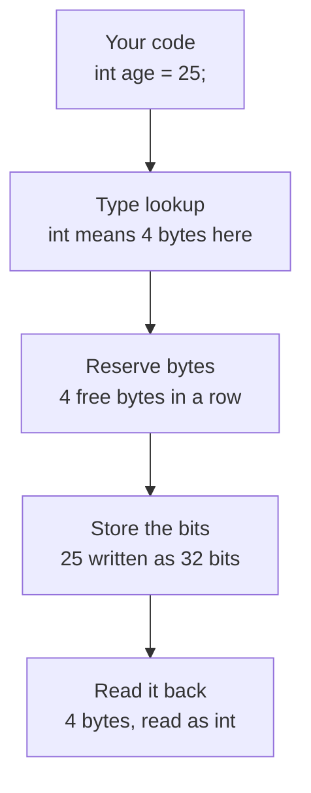

# Variables and Data Types Introduction


# How C++ data types use memory

Memory is one long run of bytes, and every byte is 8 bits. A variable is a chunk of those bytes, and its **type** decides two things:

1. **How many bytes** it claims.
2. **How the bits are read**: as a whole number, a decimal, a character, and so on.

The bits carry no type information of their own. The bytes `19 00 00 00` can be the `int` 25, or four unrelated characters. Only the declared type tells the compiler how to read them.

---

## What happens when you write `int age = 25;`



1. The compiler sees the type `int` and looks up its size (4 bytes on typical machines).
2. It finds 4 free, contiguous bytes at a suitably aligned address.
3. It writes `25` into them as binary.
4. Every later use of `age` reads those same 4 bytes and interprets them as an `int`.

---

## What the memory looks like

Each row below is 4 bytes (32 bits). Only the second row belongs to `age`. The other bits are leftovers from other variables and are arbitrary.

```
address   byte 0    byte 1    byte 2    byte 3
0x1000    01101110  00110000  11110001  00111111   other memory
0x1004    00011001  00000000  00000000  00000000   int age = 25
0x1008    10100101  01011100  00000011  11000010   other memory
```

Bytes are stored **lowest address first**, and on most machines (x86, ARM) the *least significant* byte comes first. This is called **little-endian**. So 25 (`0x00000019`) appears as `19 00 00 00`.

---

## Typical sizes

These are the usual values on a 64-bit desktop. C++ only guarantees `sizeof(char) == 1`, so use `sizeof` to check your own machine.

| Type | Typical size | Range or precision |
|------|--------------|--------------------|
| `char` | 1 byte | −128 to 127 (usually signed) |
| `bool` | 1 byte | `false` or `true` |
| `short` | 2 bytes | −32,768 to 32,767 |
| `int` | 4 bytes | −2,147,483,648 to 2,147,483,647 |
| `long` | 4 bytes on Windows, 8 on Linux and macOS | depends on size |
| `long long` | 8 bytes | about ±9.2 × 10¹⁸ |
| `float` | 4 bytes | about ±3.4 × 10³⁸, ~7 digits |
| `double` | 8 bytes | about ±1.8 × 10³⁰⁸, ~16 digits |
| pointer | 8 bytes (64-bit) | holds an address |

---

## Worked examples

Bytes are shown in memory order, lowest address first.

| Declaration | Bytes (hex) | Bits |
|-------------|-------------|------|
| `char c = 'A';` | `41` | `01000001` |
| `bool flag = true;` | `01` | `00000001` |
| `short s = 1000;` | `E8 03` | `11101000 00000011` |
| `int age = 25;` | `19 00 00 00` | `00011001 00000000 00000000 00000000` |
| `long long big = 5000000000;` | `00 F2 05 2A 01 00 00 00` | 64 bits, 5 of the 8 bytes are non-zero |
| `float f = 0.1f;` | `CD CC CC 3D` | `11001101 11001100 11001100 00111101` |
| `double d = 0.1;` | `9A 99 99 99 99 99 99 3F` | 64 bits |

### Things worth noticing

**Overflow wraps around.** A `char` has only 8 bits, so `char c = 300;` keeps just the low 8 bits. `300 − 256 = 44`, so you get `44`.

**Same number, different footprint.** `int n = 25;` uses 4 bytes. `long long n = 25;` uses 8, and the extra bytes are zeros.

**A `bool` costs a whole byte.** Memory is addressed per byte, so one yes/no still takes 8 bits.

**Decimals are approximations.** Neither `float` nor `double` can store 0.1 exactly:

| Type | Value actually stored |
|------|-----------------------|
| `float` | 0.100000001490116… |
| `double` | 0.100000000000000005551… |

The `double` just has more bits to get closer.

---

## How `float` and `double` use their bits

Floating-point numbers split their bits into three fields instead of storing a plain binary integer.

| Type | Sign | Exponent | Mantissa | Total |
|------|------|----------|----------|-------|
| `float` | 1 bit | 8 bits | 23 bits | 32 bits |
| `double` | 1 bit | 11 bits | 52 bits | 64 bits |

For `float f = 0.1f;` the 32 bits (`0x3DCCCCCD`) split as:

```
sign  exponent  mantissa
0     01111011  10011001100110011001101
```

---

## Alignment and padding

CPUs read memory fastest when a value sits at an address divisible by its size. That is why `int` lands at `0x1004` and `double` at `0x1008` in the examples above. The compiler may insert hidden **padding** bytes to keep things aligned:

```cpp
struct Example {
    char a;   // 1 byte, then 3 bytes of padding
    int  b;   // 4 bytes
};
// sizeof(Example) is typically 8, not 5
```

---

## Try it yourself

```cpp
#include <cstdio>
#include <cstring>

int main() {
    int age = 25;

    unsigned char bytes[sizeof(age)];
    std::memcpy(bytes, &age, sizeof(age));

    std::printf("sizeof(int) = %zu\n", sizeof(age));
    for (unsigned char b : bytes) {
        std::printf("%02X ", b);   // prints 19 00 00 00 on little-endian machines
    }
    std::printf("\n");
}
```

Change `age` to other values or types and watch how the bytes change.

---

# Number Systems

Since humans cannot understand the computer language we use numbers system to understand. 


