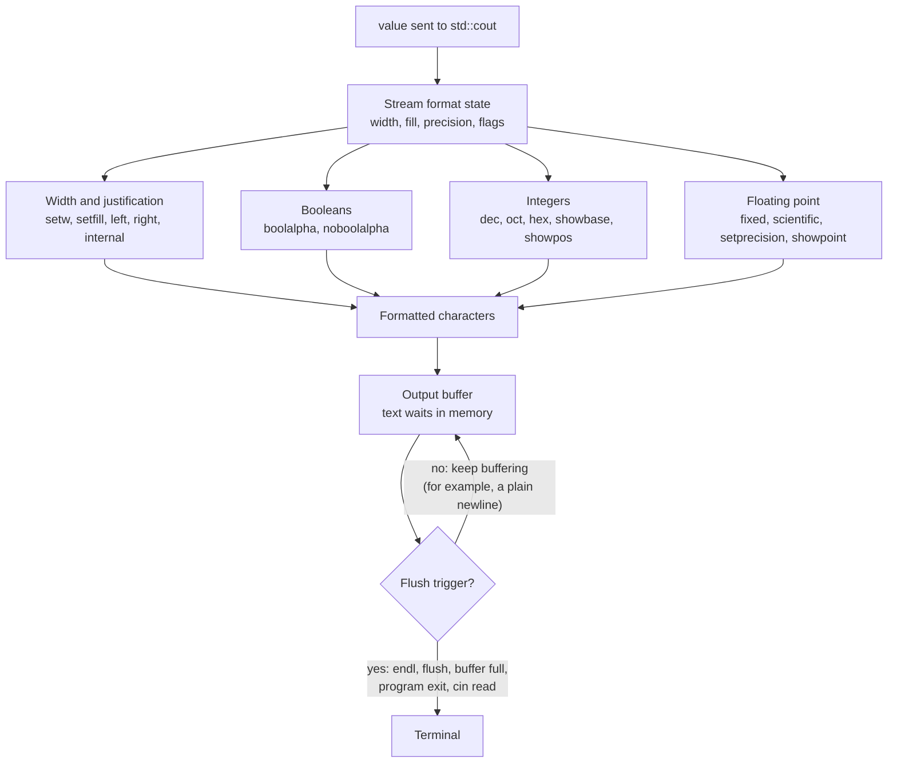

# Output Formatting

Output formatting in C++ refers to **controlling how information is displayed in the terminal**.

By default, C++ displays output using its default formatting rules. However, sometimes we want to control:

- Number of decimal places.
- Width of output.
- Alignment of text.
- Spaces between values.
- Whether Boolean values appear as `true` or `false`.
- The number base (decimal, octal, hexadecimal) of integers.
- Whether numbers are shown in fixed or scientific notation.

C++ provides several manipulators and functions to format output.

## 1. Headers Used for Output Formatting

```cpp
#include <ios>       // base formatting flags: boolalpha, showpos, hex, dec, oct, showbase,
                     // fixed, scientific, showpoint, left, right, internal
#include <iostream>  // std::cout, std::endl, std::flush (includes <ios> internally)
#include <iomanip>   // parameterised manipulators: setw, setfill, setprecision
```

| Header | Provides |
|---|---|
| `<ios>` | The formatting flags and the simple (no-argument) manipulators |
| `<iostream>` | `std::cout`, `std::cin`, `std::endl`, `std::flush` |
| `<iomanip>` | Manipulators that take an argument: `setw()`, `setfill()`, `setprecision()` |

`<iostream>` already pulls in `<ios>`, so writing it explicitly is optional. `<iomanip>` is the only one you must add yourself, whenever you use a manipulator that takes an argument.

## 2. The Output Buffer: `std::endl`, `\n` and `std::flush`

`std::cout` does not write characters straight to the screen. It writes them into an **output buffer** in memory, and the buffer is sent to the terminal later, in one go. This is faster than making a system call for every character.

The buffer is **flushed** (sent to the terminal) when:

- `std::endl` or `std::flush` is used.
- The buffer becomes full.
- The program ends normally.
- Input is read from `std::cin`, because `cin` is tied to `cout`.
- A newline is printed to an interactive terminal (this depends on the implementation, so do not rely on it).

### `\n`

Inserts a newline character and nothing else. It does not force a flush.

```cpp
std::cout << "Hello\n";
```

### `std::endl`

Inserts a newline character **and then flushes** the buffer. It is the same as `'\n'` followed by `std::flush`.

```cpp
std::cout << "Hello" << std::endl;

// same as:
std::cout << "Hello\n" << std::flush;
```

### `std::flush`

Flushes the buffer **without** inserting a newline. It is useful for prompts and progress messages that must appear immediately and keep the cursor on the same line.

```cpp
std::cout << "Loading..." << std::flush;   // appears now, no newline
```

### Comparison

| | `\n` | `std::endl` | `std::flush` |
|---|---|---|---|
| Adds a newline | Yes | Yes | No |
| Flushes the buffer | No | Yes | Yes |
| Speed | Fastest | Slower (forced flush) | Slower (forced flush) |
| Use when | Normal line breaks | A line must be shown immediately | Output must appear without a newline |

> **Tip:** Use `\n` by default. Reach for `std::endl` or `std::flush` only when output must appear immediately, such as prompts, progress bars, or logging before a possible crash.

## 3. Flowchart: How a Value Travels From `std::cout` to the Terminal



How to read it:

- **Stream format state:** the stream remembers its width, fill character, precision and flags. Manipulators change this state, and `std::cout` applies it to each value it prints.
- **Four branches:** a value is formatted according to its type. Booleans use `boolalpha`, integers use the base and sign flags, floating-point numbers use `fixed`, `scientific`, `setprecision` and `showpoint`, and `setw` with `left`/`right` pads any of them.
- **Buffer, then flush:** the formatted text goes into the output buffer and only reaches the terminal when a flush trigger fires.

## 4. Sticky vs Non-Sticky Manipulators

Most manipulators stay active until you change them. Only `std::setw()` resets after a single output.

| Manipulator | Stays active? |
|---|---|
| `setw` | No, applies to the next value only |
| `setfill`, `setprecision`, `left`, `right`, `internal` | Yes |
| `boolalpha`, `showpos`, `showbase`, `showpoint` | Yes (undo with `noboolalpha`, `noshowpos`, `noshowbase`, `noshowpoint`) |
| `dec`, `oct`, `hex` | Yes |
| `fixed`, `scientific` | Yes |

## 5. `std::setw()`

`std::setw()` is used to set the minimum width of the next output field.

It is available in the `<iomanip>` header.

### Example

```cpp
#include <iostream>
#include <iomanip>

int main()
{
    std::cout << std::setw(10) << 100 << std::endl;

    return 0;
}
```

**Output**

```text
       100
```

The output field has a minimum width of 10 characters. Since `100` occupies 3 characters, the remaining 7 spaces are added before it by default.

> **Important:** `std::setw()` generally affects only the next formatted output field. You need to apply it again for subsequent fields.

### Practical Example

```cpp
#include <iostream>
#include <iomanip>

int main()
{
    std::cout << std::setw(10) << "Name"
              << std::setw(10) << "Age" << std::endl;

    std::cout << std::setw(10) << "Alex"
              << std::setw(10) << 20 << std::endl;

    return 0;
}
```

**Output**

```text
      Name       Age
      Alex        20
```

## 6. Justification: `std::left`, `std::right` and `std::internal`

These manipulators control the alignment of output within a field set by `std::setw()`.

- `std::left` aligns output to the left.
- `std::right` aligns output to the right (the default).
- `std::internal` puts the padding between the sign or base prefix and the digits.

### Example

```cpp
#include <iostream>
#include <iomanip>

int main()
{
    std::cout << std::left << std::setw(15) << "C++"
              << "Programming" << std::endl;

    std::cout << std::right << std::setw(15) << "C++"
              << "Programming" << std::endl;

    return 0;
}
```

**Output**

```text
C++            Programming
            C++Programming
```

The alignment setting remains active for subsequent output until changed.

### `std::internal`

```cpp
std::cout << std::internal << std::showpos << std::setw(8) << 42 << std::endl;
```

**Output**

```text
+     42
```

## 7. `std::setfill()`

`std::setfill()` changes the character used to fill empty spaces created by `std::setw()`.

### Example

```cpp
#include <iostream>
#include <iomanip>

int main()
{
    std::cout << std::setfill('*') << std::setw(10) << 100 << std::endl;

    return 0;
}
```

**Output**

```text
*******100
```

Here:

- `std::setfill('*')` changes the fill character to `*`.
- `std::setw(10)` sets the output width to 10.

The fill character stays active until you change it again (for example with `std::setfill(' ')`).

## 8. `std::boolalpha`

By default, Boolean values are displayed as `1` and `0`.

Using `std::boolalpha`, we can display them as `true` and `false`.

```cpp
#include <iostream>

int main()
{
    bool isStudent = true;

    std::cout << isStudent << std::endl;

    std::cout << std::boolalpha;
    std::cout << isStudent << std::endl;

    return 0;
}
```

**Output**

```text
1
true
```

To switch back to `1` and `0`, use `std::noboolalpha`.

## 9. Integer Formatting: `showpos`, `dec`, `oct`, `hex`, `showbase`

```cpp
#include <iostream>

int main()
{
    int n = 255;

    std::cout << std::showpos << n << "\n";                 // +255
    std::cout << std::noshowpos;

    std::cout << std::dec << n << "\n";                     // 255
    std::cout << std::oct << n << "\n";                     // 377
    std::cout << std::hex << n << "\n";                     // ff
    std::cout << std::showbase << std::hex << n << "\n";    // 0xff
    std::cout << std::showbase << std::oct << n << "\n";    // 0377

    return 0;
}
```

**Output**

```text
+255
255
377
ff
0xff
0377
```

- `std::showpos` prints a `+` before non-negative numbers.
- `std::dec`, `std::oct` and `std::hex` switch the number base (decimal is the default).
- `std::showbase` adds the base prefix: `0x` for hexadecimal and `0` for octal.
- The base stays in effect, so switch back with `std::dec` when you are done.

## 10. Floating-Point Formatting: `setprecision`, `fixed`, `scientific`

### `std::setprecision()`

`std::setprecision()` is used to control the precision of floating-point numbers.

It is available in the `<iomanip>` header.

```cpp
#include <iostream>
#include <iomanip>

int main()
{
    double pi = 3.14159265359;

    std::cout << std::setprecision(4) << pi << std::endl;

    return 0;
}
```

**Output**

```text
3.142
```

By default, `std::setprecision()` controls the total number of significant digits, not necessarily the number of decimal places.

### Using `std::fixed`

If we want to control the number of digits after the decimal point, we can combine `std::fixed` with `std::setprecision()`.

```cpp
#include <iostream>
#include <iomanip>

int main()
{
    double pi = 3.14159265359;

    std::cout << std::fixed << std::setprecision(2) << pi << std::endl;

    return 0;
}
```

**Output**

```text
3.14
```

Here:

- `std::fixed` switches to fixed-point notation.
- `std::setprecision(2)` displays exactly two digits after the decimal point.

### Using `std::scientific`

`std::scientific` displays numbers in scientific (exponent) notation.

```cpp
double x = 12345.6789;

std::cout << std::scientific << std::setprecision(3) << x << std::endl;
```

**Output**

```text
1.235e+04
```

### What `setprecision(n)` means in each mode

| Mode | Meaning of `n` |
|---|---|
| Default (`std::defaultfloat`) | `n` significant digits |
| `std::fixed` | `n` digits after the decimal point |
| `std::scientific` | `n` digits after the decimal point in the mantissa |

To return to the default mode, use `std::defaultfloat`.

## 11. `std::showpoint`

By default, C++ may omit trailing zeros or the decimal point when displaying floating-point values.

`std::showpoint` forces the decimal point and trailing zeros to be displayed.

### Example

```cpp
#include <iostream>
#include <iomanip>

int main()
{
    double number = 10.0;

    std::cout << number << std::endl;

    std::cout << std::showpoint << number << std::endl;

    return 0;
}
```

**Output**

```text
10
10.0000
```

## Practical Example: Formatted Student Report

We can combine multiple formatting manipulators to create a properly aligned student report.

```cpp
#include <iostream>
#include <iomanip>
#include <string>

int main()
{
    std::string name = "Alex";
    int age = 20;
    double marks = 89.5678;

    std::cout << std::left;

    std::cout << std::setw(15) << "Name"
              << std::setw(10) << "Age"
              << std::setw(10) << "Marks" << std::endl;

    std::cout << std::setw(15) << name
              << std::setw(10) << age
              << std::fixed << std::setprecision(2) << marks
              << std::endl;

    return 0;
}
```

**Output**

```text
Name           Age       Marks
Alex           20        89.57
```

## Common Output Formatting Manipulators

| Manipulator | Purpose | Header |
|---|---|---|
| `std::endl` | Inserts newline and flushes output | `<iostream>` |
| `std::flush` | Flushes output without a newline | `<iostream>` |
| `std::setw(n)` | Sets minimum output width (next value only) | `<iomanip>` |
| `std::setfill(c)` | Sets the padding character | `<iomanip>` |
| `std::setprecision(n)` | Controls floating-point precision | `<iomanip>` |
| `std::left` | Left alignment | `<ios>` / `<iostream>` |
| `std::right` | Right alignment | `<ios>` / `<iostream>` |
| `std::internal` | Padding between sign/prefix and digits | `<ios>` / `<iostream>` |
| `std::boolalpha` | Displays Boolean values as words | `<ios>` / `<iostream>` |
| `std::noboolalpha` | Displays Boolean values as 0 or 1 | `<ios>` / `<iostream>` |
| `std::showpos` | Shows `+` for non-negative numbers | `<ios>` / `<iostream>` |
| `std::dec`, `std::oct`, `std::hex` | Selects the integer base | `<ios>` / `<iostream>` |
| `std::showbase` | Shows the base prefix (`0x`, `0`) | `<ios>` / `<iostream>` |
| `std::fixed` | Uses fixed-point notation | `<ios>` / `<iostream>` |
| `std::scientific` | Uses scientific notation | `<ios>` / `<iostream>` |
| `std::showpoint` | Forces decimal point display | `<ios>` / `<iostream>` |

## Note

- Output formatting controls how information appears in the terminal.
- `std::cout` writes to an output buffer, and the buffer is flushed to the terminal later.
- `\n` only adds a newline, `std::endl` adds a newline and flushes, and `std::flush` only flushes.
- `<iomanip>` provides manipulators such as `setprecision()`, `setw()` and `setfill()`.
- `std::setw()` affects only the next value, while most other manipulators stay active.
- `std::fixed`, `std::scientific` and `std::setprecision()` control how floating-point numbers appear.
- `std::left`, `std::right` and `std::internal` control alignment.
- `std::dec`, `std::oct`, `std::hex`, `std::showbase` and `std::showpos` control integer display.
- `std::boolalpha` displays Boolean values as words.
- Formatting manipulators make terminal output more organised and readable.

---