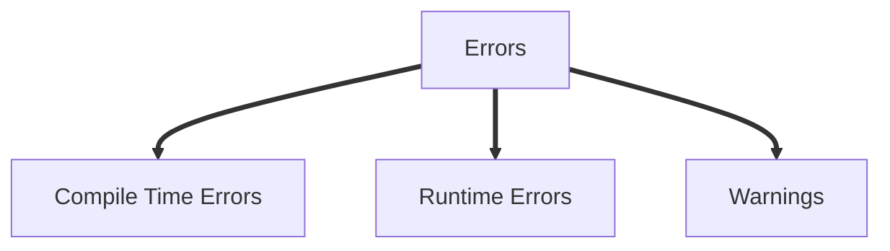
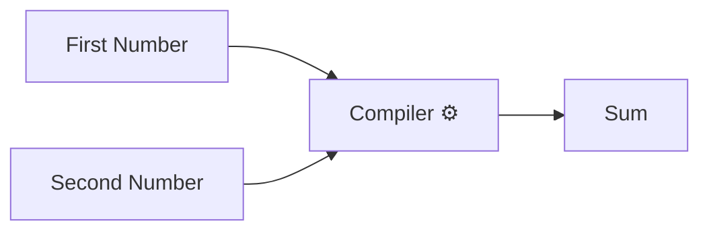

# Introduction

```cpp
#include <iostream>


int main(){
    std::cout << "Hello World!" << std::endl;
    return 0; 
}

```

In the above example program, at the top of the program the `#include <iostream>` is used to import a library which allows the use of std::cout, which is a print function.

- CPP statements need to end with semi-colon `;`

- A function is a block of code which does many things, in CPP main fuction should be always included, because it instructs the compiler where the code runs from, apart from main, an user can define any number of functions
  
- Main function is also called the entry point of a program, because it is the very first thing that is run when we run a cpp program
  
- Statements in the main function are run in order from top to bottom, and the program is going to end with it hits the end of the function block
  
- `std:endl;` is used to insert a new line, whereas the `std::cout` is used to print text in the terminal.

- The `return 0;` is used as a way for the main function to send the message to the operating system if it finished successfully or if there was a problem

# Comments

Comments are statements in CPP which will be ignored by the compiler and wont be shown during the execution of the program.

- There are two types of comments
  - Single Line Comments
  - Multi-line comments

Comments are used to add developer notes, todo lists, explain how the program works, or just ignore a few statements during testing, logging changes.

> **⚠️ Note: You cannot nest comments in CPP**

### Single Line Comments
Used to comment a single line of code
- Single line comments are started with `//`

### Multi-Line Comments
Used to comment multiple lines of code
- Multi-line line comments are started with `/*` and end with `*/`

Example Of Comments:

```cpp
#include <iostream>

int main() {
    std::cout << "Hello World!" << std::endl; //THIS IS A SINGLE LINE COMMENT
    return 0;
    /* This is an example of
    multi
    line
    comment
    */
}
```

> **📝 Tip: Comments are used to document your code, however it is not a good practice to not overdo comments in your code**


# Errors and Warnings

There are three kinds of errors


# Compile-Time Errors

Compile-time errors are mistakes the compiler catches **before** your program is built. No executable is produced until you fix them.

## Common Types

### 1. Syntax error
```cpp
int x = 10      // missing semicolon
```
`error: expected ';'`

### 2. Undeclared variable
```cpp
count = 5;      // never declared
```
`error: 'count' was not declared in this scope`

### 3. Type mismatch
```cpp
int n = "hello";   // text into an int
```
`error: invalid conversion from 'const char*' to 'int'`

### 4. Changing a const
```cpp
const int x = 5;
x = 10;
```
`error: assignment of read-only variable 'x'`

### 5. Wrong function arguments
```cpp
int add(int a, int b) { return a + b; }
add(1);         // too few arguments
```
`error: too few arguments to function 'add'`

### 6. Redeclaration
```cpp
int a = 1;
int a = 2;      // same name, same scope
```
`error: redeclaration of 'int a'`

### 7. Private access
```cpp
class Account { int balance; };
Account a;
a.balance = 100;   // private
```
`error: 'balance' is private within this context`

### 8. Creating an abstract class object
```cpp
struct Shape { virtual double area() = 0; };
Shape s;
```
`error: cannot declare variable 's' to be of abstract type 'Shape'`

### 9. Template error
```cpp
std::sort(v.begin(), v.end());   // type has no operator<
```
`error: no match for 'operator<'`

### 10. Failed static_assert
```cpp
static_assert(sizeof(int) == 8, "int must be 8 bytes");
```
`error: static assertion failed`

## Linker Error (a different stage)

The code compiles, but a function is declared and never defined:

```cpp
void foo();
int main() { foo(); }
```
`undefined reference to 'foo()'`

<hr>

# Runtime Errors

Runtime errors happen **while the program is running**. The code compiled fine, but something goes wrong when it executes.

## Common Types

### 1. Null pointer dereference
```cpp
int* p = nullptr;
*p = 5;              // crash
```
`Segmentation fault`

### 2. Out-of-bounds access
```cpp
int arr[3] = {1, 2, 3};
std::cout << arr[10];    // undefined behavior
```
May print garbage or crash. With `std::vector`, `v.at(10)` throws `std::out_of_range` instead.

### 3. Division by zero
```cpp
int a = 10, b = 0;
std::cout << a / b;
```
`Floating point exception` (crash)

### 4. Uncaught exception
```cpp
throw std::runtime_error("oops");   // no try/catch
```
`terminate called after throwing an instance of 'std::runtime_error'`

### 5. Stack overflow (infinite recursion)
```cpp
void f() { f(); }
```
`Segmentation fault`

### 6. Use after free
```cpp
int* p = new int(5);
delete p;
std::cout << *p;     // memory already freed
```
Undefined behavior.

### 7. Double free
```cpp
int* p = new int(5);
delete p;
delete p;            // freed twice
```
`free(): double free detected`

### 8. Memory leak
```cpp
int* p = new int(5);
// never deleted
```
No crash, but memory is wasted. Fix by using `std::unique_ptr`.

### 9. Uninitialized variable
```cpp
int x;
std::cout << x;      // random value
```
Undefined behavior.

### 10. Out of memory
```cpp
int* big = new int[1000000000000];
```
`terminate called after throwing an instance of 'std::bad_alloc'`

### 11. Infinite loop
```cpp
while (true) { }
```
Program hangs. Stop it with `Ctrl + C`.


<hr>

# Warnings

Warnings are **not errors**. The program still compiles, but the compiler is telling you the code looks risky or wrong.

## Common Types

### 1. Unused variable
```cpp
int x = 5;           // never used
```
`warning: unused variable 'x'`

### 2. Unused parameter
```cpp
void f(int a) { }
```
`warning: unused parameter 'a'`

### 3. Uninitialized variable
```cpp
int x;
std::cout << x;
```
`warning: 'x' is used uninitialized`

### 4. Missing return
```cpp
int f() { }          // no return statement
```
`warning: no return statement in function returning non-void`

### 5. Signed/unsigned comparison
```cpp
std::vector<int> v{1, 2, 3};
for (int i = 0; i < v.size(); i++) { }
```
`warning: comparison of integer expressions of different signedness`

### 6. Narrowing conversion
```cpp
double d = 3.14;
int n = d;           // loses the .14
```
`warning: conversion from 'double' to 'int' may change value`

### 7. Switch fallthrough
```cpp
switch (x) {
    case 1: doA();   // no break
    case 2: doB(); break;
}
```
`warning: this statement may fall through`

### 8. Assignment in a condition
```cpp
if (x = 5) { }       // meant ==
```
`warning: suggest parentheses around assignment used as truth value`

### 9. printf format mismatch
```cpp
printf("%d", 3.14);
```
`warning: format '%d' expects 'int', but argument has type 'double'`

> ⚠️ **Note:** Do not worry about the programs or the technical words mentioned above, they are only there to make you understand the concept, we will be covering them later on
 


 # Statements and Functions

 - A statement is a basic unit of computation in a C++ program
 - Every C++ program is a collection of statements organised in a certain way to achieve some goal 
 - Statements end with a `;` (semi-colon)


```cpp

int main (int argc, char **argv){

    int firstNumber = 20;
    int secondNumber = 10;

    int sum = firstNumber + secondNumber;

    std::cout << "The Sum Of the Two Numbers is: : " << sum << std::endl;

    return 0;
}

```

- Statements are executed in order from top to bottom when the program is run.
- Execution keeps going until there is a statement causing the program to terminate, or run another sequence of statements.



A funnction is like a machine, you give it input and it will give you an output.
For ex: In the above flowchart, the first number and second number are inputs and the sum is the output

CPP has a special syntax used to define functions, as shown below

```cpp
int addNUmbers(int firstNumber, int secondNumber){
    int sum = firstNumber + secondNumber;
    return sum;
}
```
- Everything inside the `(int firstNumber, int secondNumber)` or `()` are called the function parameters
- A function starts with a function type `int` (here), then a function name `addNumbers` (here) and then the parameters, followed by `{}`
- All the statements to be run in the function are stored inside the `{}`

- A function must be defined before it's use

```cpp
int addNumbers(int firstNumber, int secondNumber){
    int sum = firstNumber + secondNumber;
    return sum;
}

int main (int argc, chat **argv){
    int firstNUmber = 20;
    int secondNumber = 10;

    sum = addNumbers(firstNumber, secondNumber);

    sum = addNumbers(33,23);

    std::cout << "The sum of two numbers is: " << sum << std::endl;
    std::cout << "The sum of two numbers is: " << addNumbers(33,24) << std::endl;

    return 0;

}
```
- Functions thus are, reusable pieces of code that group together a bunch of statements to do whatever we want to do in that function.
  